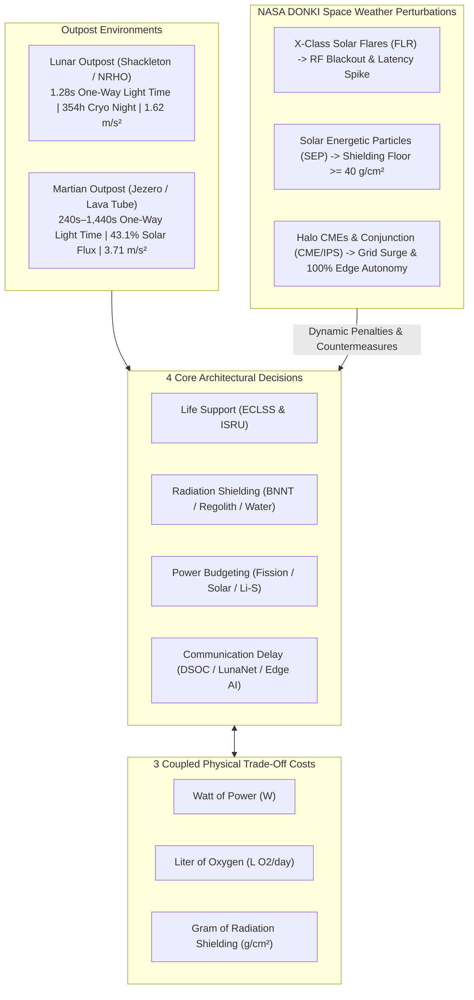
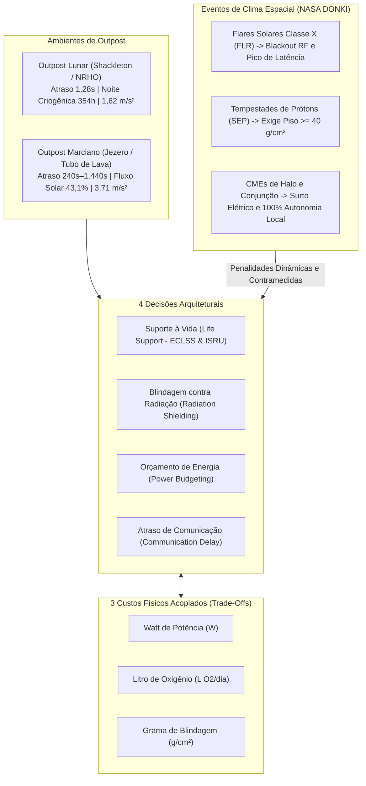

## Architectural Decision Rules

    

        <b>🇺🇸 English (en-US) — Outpost Architectural Decision Rules, Cost Trade-Offs and NASA/Partner API Rationale</b>
    

### 1. Outpost Environments & Core Architectural Decisions

Both **`SimulatorML`** (the `.NET 11` `x64` Quad-Ensemble `ML.NET` training and TUI engine) and **`Simulator`** (the `Blazor WebAssembly`) enforce a coupled **Outpost Systems Architecture** across two primary surface/orbital outpost environments—**Lunar Outpost (`LunarOutpost` — Shackleton South Pole & Gateway NRHO)** and **Martian Outpost (`MartianOutpost` — Jezero/Arcadia ISRU Base)**—alongside **Low Earth Orbit (`ISS`)** as the baseline validation testbed.

Every deck loadout and card play in `bioship_decks_catalog.json` (`SchemaVersion: 7.0`) requires balancing **four core architectural decisions** against **three physical resource costs (trade-offs)** under dynamic **NASA DONKI space weather events**:

#### The 4 Architectural Decisions vs. 3 Physical Trade-Off Costs

| Architectural Decision | Primary Engineering Trade-Off | Watt of Power (`W`) Cost/Gain | Liter of Oxygen (`L/day`) Impact | Gram of Shielding (`g/cm²`) Impact |
| :--- | :--- | :--- | :--- | :--- |
| **1. Life Support (`LifeSupport`)** | Closed-loop Marshall ECLSS (`WPA`/`BPA`/`OGA`/`CDRA`/`Sabatier`) + *Chlorella* PBR (`OSD-521`) vs. open-loop resupply. | High continuous draw (`1,800 W` to `14,500 W`) to drive PEM water electrolysis, Sabatier heaters, and UV LEDs. | Generates `+210` to `+7,800 L O2/day` (vs. `588 L O2/day` or `0.84 kg/day` consumed per astronaut). | Water jackets and algal PBR tanks contribute `+1.5` to `+12.5 g/cm²` of hydrogen-rich passive shielding. |
| **2. Radiation Shielding (`RadiationShielding`)** | Passive mass shielding (`BNNT`, sintered lunar regolith vaults, Martian lava tubes) vs. active toroidal magnetic shields. | Passive shielding costs robotic sintering/pumping power (`450 W` to `6,200 W`); active magnetoshields draw up to `9,200 W`. | Prevents radiation-induced die-off of *Chlorella* cultures (saving up to `920 L O2/day` during SEP storms) but EVA construction consumes O2. | Adds `+12.0` to `+68.0 g/cm²` of areal density to meet the `>= 40 g/cm²` storm shelter floor. |
| **3. Power Budgeting (`PowerBudgeting`)** | Continuous nuclear fission (`Kilopower KRUSTY` / `FSP`) + `SABERS` Li-S batteries vs. solar irradiance drop (`43.1%` on Mars) and 14-day lunar nights. | Supplies `+32,000 W` to `+145,000 W` of base electrical capacity; thermal radiators (`EATCS`) draw `3,000 W` to reject waste heat. | Regenerative fuel cells consume `-480 L O2/day` during dust storms unless backed by nuclear fission. | Reactor shadow shields and cryo-depots add `+3.0` to `+10.0 g/cm²` of localized attenuation. |
| **4. Communication Delay (`CommunicationDelay`)** | Earth-relied telemetry vs. high-gain optical links (`DSOC` / `LunaNet`) and onboard `Quad-Ensemble ML.NET` edge autonomy during Mars conjunction (`24 min` one-way delay). | Laser transceivers and edge compute draw `3,200 W` to `6,500 W` from the outpost power bus. | Autonomous robotic EVA repairs (`Valkyrie R5` / `Canadarm3`) save `+180` to `+350 L O2/day` by avoiding human spacewalks. | Deep-space lava tube placement adds `+68 g/cm²` shielding at the cost of `+45s` local surface relay latency. |

---

### 2. Why Each NASA & Partner API Is Used in the Simulator

To ensure that every card in `bioship_decks_catalog.json` and every decision tree in the **240,000-sample `ML.NET` Quad-Ensemble** reflects real aerospace physics rather than arbitrary game numbers, the project integrates **9 public NASA & Partner APIs**:

| NASA / Partner API | Endpoint / Identifier Used | Architectural Decision Domain | Why It Is Used in `SimulatorML` & `Simulator` |
| :--- | :--- | :--- | :--- |
| **1. [NASA DONKI API](https://api.nasa.gov/)** (`FLR`, `SEP`, `CME`, `IPS`) | `https://api.nasa.gov/DONKI/FLR` `https://api.nasa.gov/DONKI/SEP` `https://api.nasa.gov/DONKI/CME` | **Radiation Shielding, Power Budgeting & Comms Delay** | Injects real-time **Solar Flares (`FLR`)**, **Solar Energetic Proton (`SEP`)** storms, and **Coronal Mass Ejections (`CME`)** into `DonkiSpaceWeatherEventsDeck`. Drives dynamic spikes in `EffectiveRadiationIndex`, forces `>= 40 g/cm²` shielding checks, triggers solar array Watt penalties, and models HF/Ka-band radio blackouts (`CommunicationDelaySpikeSec`). |
| **2. [NASA Image and Video Library API](https://images.nasa.gov/)** | `https://images-api.nasa.gov/search?q=...&media_type=image` `https://images-assets.nasa.gov/image/{id}/{id}~medium.jpg` | **Visual Card Asset Pipeline (All 5 Deck Sets)** | Populates `NasaImageApiUrl` and `NasaImageAssetUrl` on every single card (`44` cards total) so the `.NET MAUI Blazor` card game dynamically renders authentic public-domain NASA photography inside the 90-degree rectangular card template window. |
| **3. [NASA JPL Horizons API](https://ssd-api.jpl.nasa.gov/doc/horizons.html)** | `https://ssd.jpl.nasa.gov/api/horizons.api` (`COMMAND='-125544'`, `'301'`, `'499'`) | **Outpost Environment, Power & Comms Delay** | Computes exact Earth–target distances (`384,400 km` Moon; `78.34M–401M km` Mars) to derive one-way light-time **Communication Delay** (`1.28s` Lunar vs. `240s–1,440s` Martian), inverse-square **Solar Irradiance** (`1.0x` vs. `0.431x` for solar Watt budgeting), and $\Delta v$ propellant margins. |
| **4. [NASA OSDR Biological Data API (GeneLab)](https://visualization.osdr.nasa.gov/biodata/api/)** | `https://osdr.nasa.gov/osdr/data/search?term=astronaut%20bone%20radiation%20chlorella` | **Life Support & Radiation Shielding** | Grounds crew bone demineralization, hematopoietic DNA radiation damage, SANS ocular shifts, and `OSD-521` *Chlorella vulgaris* photobioreactor $\text{O}_2$ output (`L/day` per Watt of photosynthetic LED lighting). |
| **5. [NASA TechPort API](https://techport.nasa.gov/help/api)** | `https://api.nasa.gov/techport/api/projects/182369` (*Lunar Weather Array*, `MOXIE`, `Kilopower`) | **Outpost Life Support & Power Budgeting** | Supplies technology readiness and engineering telemetry for lunar regolith electrodynamic dust shields (`EDS`), Martian `MOXIE` solid-oxide $\text{O}_2$ electrolysis (`Watts` per `Liter of O2`), and `Kilopower KRUSTY` fission surface power. |
| **6. [NASA Technology Transfer API](https://technology.nasa.gov/api/)** | `https://technology.nasa.gov/api/query/patent/water%20recovery%20eclss` | **Life Support (ECLSS Loop Closure)** | Provides patent-backed performance curves for Marshall Space Flight Center's `WRS` (`WPA` + `UPA`), `Brine Processor Assembly (BPA)` (`98.5%` water loop closure), and `Sabatier` methanation reactors. |
| **7. [NASA NTRS OpenAPI](https://ntrs.nasa.gov/api/openapi/)** | `https://ntrs.nasa.gov/api/citations/search` ([NTRS 20190027563](https://ntrs.nasa.gov/api/citations/20190027563/downloads/20190027563.pdf), [ICES-2026-190](https://ntrs.nasa.gov/api/citations/20260003012/downloads/ICES-2026-190_Final.pdf)) | **Trade-Off Cost Calibration (`W`, `L O2`, `g/cm²`)** | Establishes the exact human metabolic baseline (`0.84 kg` / `588 L O2/day`, `1.04 kg CO2/day`, `3.54 L H2O/day`, `0.62 kg dry food/day` per crewmember) used in `ComputeQuadThreeDeckTargets`. |
| **8. [NASA InSight Mars Weather Service API](https://api.nasa.gov/assets/insight/InSight%20Weather%20API%20Documentation.pdf)** | `https://api.nasa.gov/insight_weather/?api_key=DEMO_KEY&feedtype=json&ver=1.0` | **Martian Outpost Power & Thermal Budgeting** | Models Martian surface atmospheric pressure (`~745 Pa` for `MOXIE` intake compression Watts), extreme diurnal thermal swings (`-62.5°C` mean), and dust storm solar attenuation. |
| **9. [CelesTrak / NASA TLE Orbital API](https://tle.ivanstanojevic.me/)** (Partner) | `https://tle.ivanstanojevic.me/api/tle/25544` (NORAD Catalog `25544`) | **LEO Testbed Ephemeris & SAA Radiation** | Tracks live ISS orbital decay and South Atlantic Anomaly (`SAA`) trapped-proton passes to calibrate baseline `BNNT` and Whipple shielding mass before scaling to Lunar and Martian outposts. |

<b>🇧🇷 Português (pt-BR) — Regras de Decisão Arquitetural, Custos (Trade-Offs) e Justificativa das APIs NASA/Parceiros</b>

### 1. Ambientes de Outpost e Decisões Arquiteturais do Jogo

Tanto o **`SimulatorML`** (motor `.NET 11` `x64` de treinamento do Quad-Ensemble `ML.NET` e interface TUI) quanto o **`Simulator`** (simulador web `Blazor WebAssembly` e base para o card game em `.NET MAUI`) operam sobre uma **Arquitetura de Decisões de Postos Avançados (Outposts)** focada no **Posto Lunar (`LunarOutpost` — Polo Sul em Shackleton e órbita NRHO)** e no **Posto Marciano (`MartianOutpost` — Base ISRU em Jezero/Arcadia)**, utilizando a **Estação Espacial Internacional (`ISS`)** como bancada de validação em órbita baixa.

Cada combinação de cartas no `bioship_decks_catalog.json` (`SchemaVersion: 7.0`) exige equilibrar **quatro decisões arquiteturais** contra **três custos físicos (trade-offs)** sob eventos dinâmicos de clima espacial do **NASA DONKI**:

#### As 4 Decisões Arquiteturais vs. Os 3 Custos Físicos (Trade-Offs)

| Decisão Arquitetural | Trade-Off Principal de Engenharia | Custo/Ganho em Watts (`W`) | Impacto em Litros de Oxigênio (`L/dia`) | Impacto em Gramas de Blindagem (`g/cm²`) |
| :--- | :--- | :--- | :--- | :--- |
| **1. Suporte à Vida (`LifeSupport`)** | Ciclo fechado Marshall ECLSS (`WPA`/`BPA`/`OGA`/`CDRA`/`Sabatier`) + Fotobiorreator *Chlorella* (`OSD-521`) vs. ciclo aberto. | Consumo contínuo elevado (`1.800 W` a `14.500 W`) para eletrólise PEM da água, aquecedores Sabatier e LEDs UV. | Gera `+210` a `+7.800 L O2/dia` (contra o consumo metabólico de `588 L O2/dia` ou `0,84 kg/dia` por astronauta). | Camisas d'água e tanques de algas adicionam `+1,5` a `+12,5 g/cm²` de blindagem passiva rica em hidrogênio. |
| **2. Blindagem contra Radiação (`RadiationShielding`)** | Blindagem passiva de massa (`BNNT`, abóbadas de regolito lunar sinterizado, tubos de lava em Marte) vs. escudos magnéticos toroidais ativos. | Sinterização robótica/bombeamento consome `450 W` a `6.200 W`; escudos magnéticos ativos drenam até `9.200 W`. | Evita a morte celular das culturas de *Chlorella* por radiação (preservando até `920 L O2/dia` em tempestades SEP), embora EVAs de construção gastem O2. | Adiciona `+12,0` a `+68,0 g/cm²` de densidade superficial para atingir o piso seguro de abrigo (`>= 40 g/cm²`). |
| **3. Orçamento de Energia (`PowerBudgeting`)** | Fissão nuclear contínua (`Kilopower KRUSTY` / `FSP`) + baterias `SABERS` Li-S vs. queda de irradiação solar em Marte (`43,1%`) e noite lunar de 14 dias. | Fornece `+32.000 W` a `+145.000 W` ao barramento elétrico; radiadores térmicos (`EATCS`) consomem `3.000 W` para rejeitar calor. | Células a combustível regenerativas consomem `-480 L O2/dia` durante tempestades de poeira caso não haja fissão nuclear. | Escudos de sombra dos reatores e depósitos criogênicos somam `+3,0` a `+10,0 g/cm²` de atenuação. |
| **4. Atraso de Comunicação (`CommunicationDelay`)** | Telemetria dependente da Terra vs. comunicação óptica a laser (`DSOC` / `LunaNet`) e piloto automático local `Quad-Ensemble ML.NET` durante conjunção solar (`24 min` só de ida). | Transceptores a laser e processamento de borda consomem `3.200 W` a `6.500 W` contínuos. | Robôs humanoides autônomos (`Valkyrie R5` / `Canadarm3`) economizam `+180` a `+350 L O2/dia` ao substituir caminhadas espaciais humanas. | Instalar o outpost em tubos de lava marcianos garante `+68 g/cm²` de proteção, mas adiciona `+45s` de latência de retransmissão local. |

---

### 2. Motivo do Uso de Cada API Pública da NASA e Parceiros

Para que cada carta do `bioship_decks_catalog.json` e cada árvore de decisão das **240.000 amostras do `ML.NET` Quad-Ensemble** reflita restrições físicas reais, o repositório consome **9 APIs públicas da NASA e parceiros**:

| API NASA / Parceiro | Endpoint / Identificador Utilizado | Decisão Arquitetural Atendida | Motivo do Uso no `SimulatorML` e `Simulator` |
| :--- | :--- | :--- | :--- |
| **1. [NASA DONKI API](https://api.nasa.gov/)** (`FLR`, `SEP`, `CME`, `IPS`) | `https://api.nasa.gov/DONKI/FLR` `https://api.nasa.gov/DONKI/SEP` `https://api.nasa.gov/DONKI/CME` | **Blindagem, Orçamento de Energia e Atraso de Comunicação** | Alimenta o `DonkiSpaceWeatherEventsDeck` com **Erupções Solares (`FLR`)**, **Eventos de Prótons Energéticos (`SEP`)** e **Ejeções de Massa Coronal (`CME`)** reais. Dispara picos no `EffectiveRadiationIndex`, exige piso de `>= 40 g/cm²` de blindagem, reduz a geração solar em Watts e simula blackouts de rádio (`CommunicationDelaySpikeSec`). |
| **2. [NASA Image and Video Library API](https://images.nasa.gov/)** | `https://images-api.nasa.gov/search?q=...&media_type=image` `https://images-assets.nasa.gov/image/{id}/{id}~medium.jpg` | **Pipeline Visual dos Cards (Todos os 5 Sets)** | Preenche as propriedades `NasaImageApiUrl` e `NasaImageAssetUrl` em todas as `44` cartas do catálogo, permitindo que o jogo em `.NET MAUI Blazor` carregue fotografias oficiais de domínio público da NASA dentro da janela retangular de cada card. |
| **3. [NASA JPL Horizons API](https://ssd-api.jpl.nasa.gov/doc/horizons.html)** | `https://ssd.jpl.nasa.gov/api/horizons.api` (`COMMAND='-125544'`, `'301'`, `'499'`) | **Ambiente do Outpost, Energia e Atraso de Comunicação** | Calcula a distância exata Terra–destino (`384.400 km` Lua; `78,34M–401M km` Marte) para determinar o **atraso de comunicação** (`1,28s` na Lua vs. `240s–1.440s` em Marte), o fator de **irradiação solar** (`1,0x` vs. `0,431x` no cálculo de Watts solares) e o orçamento de $\Delta v$. |
| **4. [NASA OSDR Biological Data API (GeneLab)](https://visualization.osdr.nasa.gov/biodata/api/)** | `https://osdr.nasa.gov/osdr/data/search?term=astronaut%20bone%20radiation%20chlorella` | **Suporte à Vida e Blindagem contra Radiação** | Fundamenta as curvas de perda óssea, dano ao DNA por radiação cósmica, síndrome neuro-ocular (SANS) e taxa fotossintética de $\text{O}_2$ (`L/dia` por Watt de iluminação LED) das microalgas *Chlorella vulgaris* (`OSD-521`). |
| **5. [NASA TechPort API](https://techport.nasa.gov/help/api)** | `https://api.nasa.gov/techport/api/projects/182369` (*Lunar Weather Array*, `MOXIE`, `Kilopower`) | **Suporte à Vida (ISRU) e Orçamento de Energia** | Fornece parâmetros de engenharia dos escudos eletrodinâmicos contra poeira lunar (`EDS`), da eletrólise de $\text{CO}_2$ marciano via `MOXIE` (custo em `Watts` por `Litro de O2` produzido) e dos reatores nucleares `Kilopower KRUSTY`. |
| **6. [NASA Technology Transfer API](https://technology.nasa.gov/api/)** | `https://technology.nasa.gov/api/query/patent/water%20recovery%20eclss` | **Suporte à Vida (Fechamento do Ciclo ECLSS)** | Fornece dados técnicos de patentes do Marshall Space Flight Center para o sistema de recuperação de água (`WRS`: `WPA` + `UPA`), processador de salmoura (`BPA`, fechando o ciclo hídrico em `98,5%`) e reatores `Sabatier`. |
| **7. [NASA NTRS OpenAPI](https://ntrs.nasa.gov/api/openapi/)** | `https://ntrs.nasa.gov/api/citations/search` ([NTRS 20190027563](https://ntrs.nasa.gov/api/citations/20190027563/downloads/20190027563.pdf), [ICES-2026-190](https://ntrs.nasa.gov/api/citations/20260003012/downloads/ICES-2026-190_Final.pdf)) | **Calibração dos Custos (`W`, `L O2`, `g/cm²`)** | Define o balanço de massa metabólico humano (`0,84 kg` / `588 L O2/dia`, `1,04 kg CO2/dia`, `3,54 L H2O/dia` e `0,62 kg alimento seco/dia` por tripulante) aplicado na função `ComputeQuadThreeDeckTargets`. |
| **8. [NASA InSight Mars Weather Service API](https://api.nasa.gov/assets/insight/InSight%20Weather%20API%20Documentation.pdf)** | `https://api.nasa.gov/insight_weather/?api_key=DEMO_KEY&feedtype=json&ver=1.0` | **Orçamento Térmico e Elétrico no Outpost Marciano** | Informa a pressão atmosférica superficial de Marte (`~745 Pa`, que define os Watts exigidos pelo compressor do `MOXIE`), variações térmicas diurnas (`-62,5°C` médios) e opacidade de tempestades de poeira. |
| **9. [CelesTrak / NASA TLE Orbital API](https://tle.ivanstanojevic.me/)** (Parceiro) | `https://tle.ivanstanojevic.me/api/tle/25544` (Catálogo NORAD `25544`) | **Efemérides em LEO e Radiação na Anomalia do Atlântico Sul** | Monitora a altitude real da ISS (~414,8 km) e as passagens pela Anomalia Magnética do Atlântico Sul (`SAA`) para calibrar o desgaste por oxigênio atômico (`ATOX`) e a blindagem `BNNT`/Whipple de referência. |

