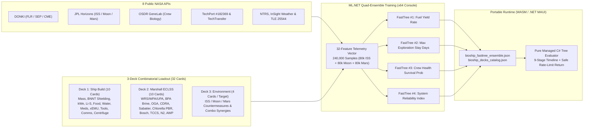
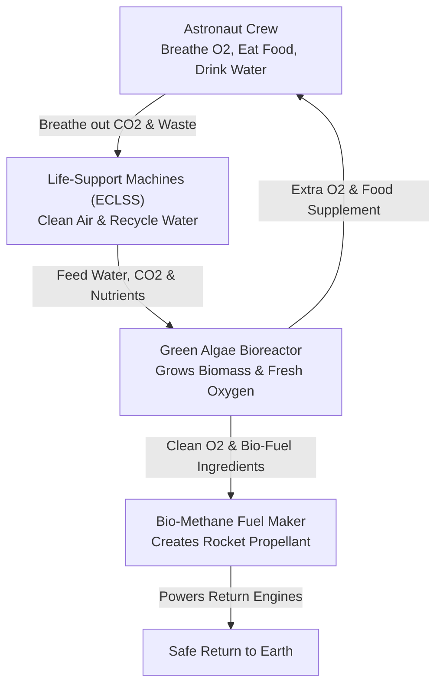
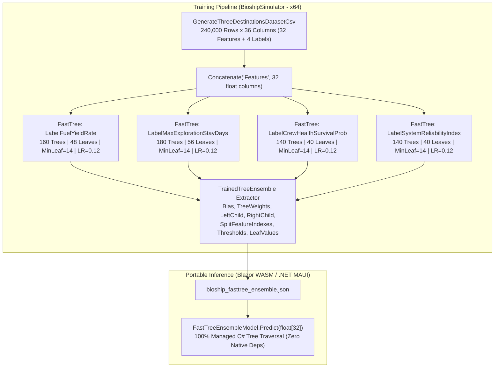

# BioShip Quad-Ensemble ML.NET Simulator (`v7.0`)

An end-to-end **Symbiotic Bio-Ship** (*Nave-Bioma*) mission simulator and **Quad-Ensemble `ML.NET` (`FastTree`)** predictive engine built on **.NET 11**, combining real-time telemetry from **8 public NASA APIs**, **Marshall Space Flight Center ECLSS** mass-balance engineering, and a **3-Deck Card-Game Architecture** for missions exclusively to the **International Space Station (`ISS`)**, **Moon (`Moon`)**, and **Mars (`Mars`)**.

---

## Architecture Overview



---

## SIMPLE

### How the Modeling Works

Imagine a **Bio-Ship** as a giant flying terrarium in space. Inside the ship, astronauts, green algae (*Chlorella*), water recyclers, and fuel-making machines all help each other survive:



To teach the computer how this living spaceship behaves in deep space without guessing, the simulator runs **240,000 practice missions**—**80,000** to the **International Space Station (ISS)**, **80,000** to the **Moon**, and **80,000** to **Mars**.

For every single practice mission, the model looks at **32 clues** (features), such as:
- How many astronauts are on board.
- How big the algae tank is and how much electricity, battery power, food, water, medicine, and spare tools the ship carries.
- Which **Ship Build**, **Life-Support (ECLSS)**, and **Destination Environment** cards are equipped.
- Real space weather and planet data downloaded from **NASA**.

Instead of using just one brain, the model trains **4 FastTree decision-tree advisors** at the same time (a **Quad-Ensemble**). Each advisor reads the 32 clues and learns to give a fast, accurate answer in milliseconds.

### What the Model Measures

Every time you change a card, add a crew member, or pick a new planet, the 4 advisors measure four vital mission scores:

| Advisor | What It Measures | Why It Matters |
| :--- | :--- | :--- |
| **1. Fuel Yield Rate** | How fast the algae and chemical reactors make new methane rocket fuel ($\text{CH}_4$). | If fuel production slows down too much, the ship cannot stay out in space safely. |
| **2. Max Exploration Stay Days** | How many days the crew can safely explore at the destination before heading home. | Finds the exact bottleneck—whether it is air, water, food, medicine, spacesuit wear, or reactor fatigue. |
| **3. Crew Health Survival** | How well the astronauts' bones, muscles, eyes, and immune systems hold up against radiation and low gravity. | Ensures the crew stays healthy throughout the entire round trip. |
| **4. System Reliability** | How healthy the spacesuits, 3D-printed spare tools, water filters, and air scrubbers remain over time. | Prevents critical hardware breakdowns far away from Earth. |

### What You Can Calculate with the Learning Model

- **Test Any Crew Size**: See how adding more astronauts increases oxygen, water, food, and medicine demand—and how much extra bioreactor volume or ECLSS hardware is needed to support them.
- **Build and Compare 3-Deck Combos**: Mix up to 5 **Ship Build** cards, 5 **ECLSS** cards, and 4 **Environment** cards to unlock special synergy bonuses and see how each card changes mission duration and safety.
- **Find the Safe Rate-Limit Turn-Around Day**: Automatically calculate the exact day the ship must fire its return engines so it always has enough fuel and healthy systems to land safely back on Earth.
- **Run Offline on Phones & Browsers**: Because the trained trees are saved into a lightweight JSON file, any web browser or mobile game can run these smart predictions instantly without needing heavy server hardware.

---

## ADVANCED

### Model Architecture & Implementation

The `BioShipSimulator` engine (`net11.0`, `x64`) implements a **Quad-Ensemble** of four independent [ML.NET FastTree](https://www.nuget.org/packages/Microsoft.ML.FastTree/) gradient-boosted regression tree models (`MLContext(seed: 42)`). Training data consists of **240,000 synthetic telemetry vectors** (**80,000 samples per operational destination**: `ISS`, `Moon`, and `Mars`) generated from a coupled biophysical, thermodynamic, and mass-balance ground-truth model calibrated against **8 public NASA REST APIs** and [NASA OCHMO ECLSS](https://www.nasa.gov/wp-content/uploads/2023/07/eclss-technical-brief-ochmo.pdf) human metabolic baselines.



#### Why Dual-Runtime Serialization (`TrainedTreeEnsemble` $\rightarrow$ JSON)?
[Microsoft.ML](https://www.nuget.org/packages/microsoft.ml/) native binaries only target `x64`/`x86` architectures and throw architecture errors on `browser-wasm` ([dotnet/machinelearning#5375](https://github.com/dotnet/machinelearning/issues/5375)). During CI/CD (`--export-only`), the `x64` console app trains all four `FastTree` ensembles, extracts the exact internal `TrainedTreeEnsemble` node arrays (`Bias`, `TreeWeights`, `LeftChild`, `RightChild`, `NumericalSplitFeatureIndexes`, `NumericalSplitThresholds`, `LeafValues`), and serializes them into `bioship_fasttree_ensemble.json`. Both `SimulatorBioship` (Blazor WebAssembly) and downstream `.NET MAUI` clients evaluate all 620 decision trees natively in pure managed C#.

#### Public NASA Data Sources Integrated
1. **Solar & Space Weather**: [NASA DONKI API](https://api.nasa.gov/) (`FLR`, `SEP`, `CME`) for real-time solar proton flux and radiation storm penalties.
2. **Orbital Ephemerides & Gravity**: [NASA JPL Horizons API](https://ssd-api.jpl.nasa.gov/doc/horizons.html) (`COMMAND='-125544'` ISS, `'301'` Moon, `'499'` Mars) for $\log_{10}(\text{distance})$, solar irradiance scaling ($1.0\times$ Earth/ISS/Moon, $0.431\times$ Mars), and surface gravity ($0.0$, $1.62$, $3.71\text{ m/s}^2$).
3. **Astronaut & Algal Biology**: [NASA OSDR GeneLab API](https://visualization.osdr.nasa.gov/biodata/api/) for bone density, muscle atrophy, radiation DNA damage, SANS, and *Chlorella* microgravity studies.
4. **Lunar Surface & Dust**: [NASA TechPort Project #182369](https://techport.nasa.gov/projects/182369) (Lunar Weather Array) for Artemis regolith and thermal extremes.
5. **ECLSS Patents**: [NASA Technology Transfer API](https://technology.nasa.gov/api/) (`water recovery eclss`) for Marshall WRS/BPA/Sabatier subsystem parameters.
6. **Technical Literature**: [NASA NTRS OpenAPI](https://ntrs.nasa.gov/api/openapi/) for mass-balance citations ([NTRS 20190027563](https://ntrs.nasa.gov/api/citations/20190027563/downloads/20190027563.pdf), [ICES-2026-190](https://ntrs.nasa.gov/api/citations/20260003012/downloads/ICES-2026-190_Final.pdf)).
7. **Martian Atmosphere**: [NASA InSight Weather API](https://api.nasa.gov/assets/insight/InSight%20Weather%20API%20Documentation.pdf) for Mars surface pressure/thermal variance.
8. **ISS Orbital Altitude**: [TLE API (NORAD 25544)](https://tle.ivanstanojevic.me/) for live ISS orbital altitude ($\sim 414.8\text{ km}$).

---

### What the Model Evaluates (32 Input Features & 4 Target Labels)

#### 32-Feature Input Vector (`SolarBioCycleData`)

| Group | Features (`[LoadColumn(0..31)]`) | Physical / Engineering Meaning |
| :--- | :--- | :--- |
| **Core Bio-Loop (10)** | `CrewCount`, `BioreactorVolumeLiters`, `WaterRecoveryEfficiency`, `BrineRecoveryEfficiency`, `OrganicBiomass`, `TechPower`, `EntropyAccumulated`, `EffectiveRadiationIndex`, `BioreactorThrottle`, `TechToBioAllocation` | Crew metabolic load (`0.84 kg O2/d`, `1.04 kg CO2/d`, `3.54 L H2O/d`, `0.62 kg food/d` per crewmember), *Chlorella* PBR volume, WRS+BPA water loop closure (`80%–99.4%`), membrane fouling entropy, and DONKI radiation stress. |
| **Target Ephemeris & Env Buffs (6)** | `TargetLog10DistanceKm`, `TargetSolarIrradianceFactor`, `TargetMissionDeltaVms`, `TargetSurfaceGravityMs2`, `CrewProtectionDeckBuff`, `BiomeShieldingDeckBuff` | Destination orbital mechanics ($\text{ISS} \approx 2.62$, $\text{Moon} \approx 5.58$, $\text{Mars} \approx 7.89\text{ }\log_{10}\text{km}$), $\Delta v$ energy budget, gravity-driven bone/muscle load, and Deck 3 countermeasure attenuation. |
| **Deck 1: Ship Build (13)** | `TotalShipMassTons`, `FoodAndProvisionsKg`, `PotableWaterReserveLiters`, `MedicalSuppliesKg`, `ElectricalPowerKw`, `BatteryStorageKwh`, `ThermalRejectionCapacityKw`, `RadShieldingGcm2`, `MicrometeoroidWhippleLayers`, `ArtificialGravityG`, `EvaSuitDurabilityPct`, `ToolsAndSparesKg`, `CommsBandwidthGbps` | Dry mass efficiency (`112t` reference), consumables autonomy, power/thermal margins (`kWe`/`kWt`), BNNT radiation attenuation (`g/cm²`), centrifuge gravity (`0–0.50g`), xEMU suit integrity, CNC spares, and DSOC optical link. |
| **Deck 2: Marshall ECLSS (3)** | `OgaCapacityKgPerDay`, `CdraScrubbingCapacityKgPerDay`, `EclssSynergyIndex` | Electrolysis $\text{O}_2$ generation (`2.3–9.2 kg/d`), 4-bed molecular sieve $\text{CO}_2$ scrubbing, and composite ECLSS subsystem synergy (Sabatier, Bosch, TCCS, APH, $\text{N}_2$ membrane). |

#### 4 Simultaneous Regression Outputs (`QuadMlPrediction`)

1. **`LabelFuelYieldRate` ($[0.14, 0.99]$)**: Models $\text{CH}_4/\text{LOX}$ synthesis efficiency from `Sabatier` ($\text{CO}_2 + 4\text{H}_2 \rightarrow \text{CH}_4 + 2\text{H}_2\text{O}$) and *Chlorella* bioreactor coupling, penalized by membrane entropy, thermal/electrical deficits, and unshielded radiation:
   $$\text{FuelYieldRate} = \text{BioTechSynergy} \times \text{LoopClosure} \times \text{GasLoopRatio}$$
2. **`LabelMaxExplorationStayDays`**: Computes the minimum safe operational horizon across **five coupled physical bottlenecks**:
   $$\text{StayDays} = \min\big(\text{EntropyDays},\; \text{FoodDays},\; \text{WaterDays},\; \text{MedicalDays},\; \text{SuitWearDays}\big)$$
   accounting for algal food supplementation (up to `60%`), net daily water loss (`3.54 L/CM-d * (1 - totalWaterLoop)`), radiation-scaled medical consumption, and xEMU suit/tool degradation rates.
3. **`LabelCrewHealthSurvivalProb` ($[0.15, 0.995]$)**: Evaluates crew physiological survival probability against microgravity bone/muscle loss (mitigated by `ArtificialGravityG` centrifuge), ionizing radiation (attenuated by BNNT `RadShieldingGcm2` and Deck 3 crew countermeasures), medical supply adequacy, and $\text{O}_2/\text{CO}_2$ loop stability.
4. **`LabelSystemReliabilityIndex` ($[0.18, 0.995]$)**: Quantifies hardware survival across `EVA` suit wear, Whipple micrometeoroid/dust shielding, thermal rejection capacity, CNC spare-parts mass, and `TCCS` biofilm/filter protection.

---

### What Can Be Calculated with the Learning Model

- **Parametric Crew & Mass-Balance Sizing**: Sweep `CrewCount` ($1\text{–}12+$), `BioreactorVolumeLiters`, and `TotalShipMassTons` to identify the exact minimum ECLSS and bioreactor capacity needed for multi-week (`ISS`), multi-month (`Moon`), or multi-year (`Mars`) campaigns.
- **3-Deck Combinatorial Optimization**: Evaluate any subset of cards from `ShipBuildDeck` (10 cards), `EclssPropertiesDeck` (10 cards), and `EnvironmentDecks` (4 cards/target) in `bioship_decks_catalog.json`, including **4 Combo Synergies** (e.g., *Closed-Loop Water & Methane*, *Deep Space Radiation & Gravity Shield*, *Bio-Regenerative Air & Food*, *Autonomous EVA & Repair*).
- **Automated Safe Rate-Limit Return Forecasting**: Continuously infer `FuelYieldRate` and `SystemReliabilityIndex` across all **9 mission stages** (from *Earth Liftoff* and *Atmosphere Exit* through *Target Exploration* to *Safe Rate-Limit Return Burn* and *Earth Touchdown*), triggering an automated return burn whenever:
  $$\text{FuelYieldRate} \le \text{SafeReturnYieldLimit} \quad \lor \quad \text{FuelReserve} \le \text{SafeReturnFuelReserve\%} \quad \lor \quad \text{SystemReliability} \le 42\%$$
- **Cross-Platform Game & Web Inference**: Export `bioship_fasttree_ensemble.json` and `bioship_decks_catalog.json` via `--export-only` for zero-dependency execution inside **Blazor WebAssembly** (`SimulatorBioship`) and **.NET MAUI** mobile card-game builds.

---

### CLI Usage (`BioShipSimulator`)

```bash
# Interactive TUI Simulation (en-US or pt-BR logs)
dotnet run --project BioshipSimulator -- --target Mars --lang en-US
dotnet run --project BioshipSimulator -- --target Moon --lang pt-BR

# Headless CI/CD Artifact Export (240k Quad-Ensemble + 3-Deck Catalog + NASA Snapshot)
dotnet run --project BioshipSimulator -- --export-only --output SimulatorBioship/wwwroot/MLArtifacts --lang en-US
```
